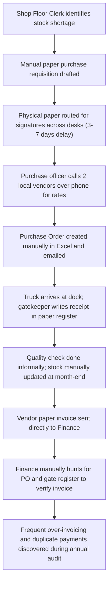
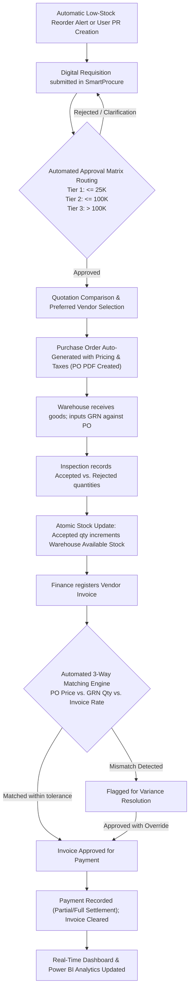
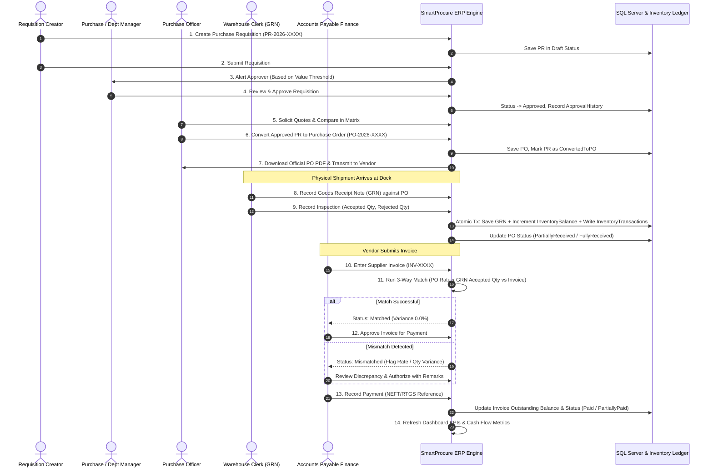

# Business Process Documentation: Procure-to-Pay (P2P) Lifecycle

**Project:** SmartProcure — SAP MM Inspired ERP System  
**Prepared By:** SAP MM Functional Consultant & Solution Architect  
**Target Enterprise:** Apex Manufacturing Industries Pvt. Ltd.  

---

### 1. SAP MM Process Mapping

In SAP ERP (ECC 6.0 and S/4HANA), the Procure-to-Pay (P2P) cycle is executed through a series of standard transaction codes (T-Codes), movement types, and organizational master records. SmartProcure mirrors these exact business logic flows in an intuitive web-based interface:

| SAP MM T-Code | SAP MM Process Description | SmartProcure Equivalent Feature | Module / Endpoint |
| :--- | :--- | :--- | :--- |
| **MM01 / MM02 / MM03** | Material Master Creation & Maintenance | Material Master Management (with UOM, Categories, Safety Stock, Reorder Point) | Module 4 (`/api/materials`) |
| **XK01 / BP** | Vendor Master / Business Partner Maintenance | Vendor Master Management (with GSTIN, PAN, Terms, Bank Ref) | Module 3 (`/api/vendors`) |
| **ME51N / ME52N / ME53N** | Create, Change, Display Purchase Requisition | Purchase Requisition Management (Line items, Priorities, Delivery dates) | Module 6 (`/api/requisitions`) |
| **ME28 / ME54N** | Release Purchase Requisition / Release Strategy | Multi-Tier Approval Workflow Engine (Tier 1, Tier 2, Tier 3 limits) | Module 7 (`/api/requisitions/{id}/approve`) |
| **ME41 / ME47 / ME49** | Request for Quotation & Price Comparison | Vendor Quotation Comparison Matrix & Selection Justification | Module 8 (`/api/quotations`) |
| **ME21N / ME22N / ME23N** | Create, Change, Display Purchase Order | Purchase Order Generation & PO PDF Dispatch | Module 9 (`/api/purchase-orders`) |
| **MIGO (Movement 101)** | Goods Receipt for Purchase Order into Warehouse | Goods Receipt Note (GRN) with Acceptance & Rejection Inspection | Module 10 (`/api/goods-receipts`) |
| **MB52 / MMBE** | Display Warehouse Stocks of Material | Perpetual Stock Ledger, Warehouse Balances & Low-Stock Alerts | Module 11 (`/api/inventory`) |
| **MIRO** | Enter Incoming Invoice (Three-Way Verification) | Supplier Invoice Verification (3-Way Match: PO vs GRN vs Invoice) | Module 12 (`/api/invoices/verify`) |
| **F-53 / F-58** | Post Outgoing Payment (Accounts Payable) | Payment Recording & Outstanding Liability Reconciliation | Module 13 (`/api/payments`) |
| **MC.9 / ME80FN** | Purchasing Information System & Analysis | Executive Procurement Dashboard, KPI Cards & Power BI Datasets | Module 14 (`/api/reports`) |

---

### 2. As-Is vs. To-Be Process Comparison

#### 2.1 The "As-Is" Manual Process

#### 2.2 The "To-Be" SmartProcure Digital ERP Process

---

### 3. Procure-to-Pay (P2P) Swimlane Workflow

---

### 4. Key Business Decision Rules

1. **Reorder Point Trigger (SAP MM Consumption-Based Planning):**
   When $\text{Available Stock} \le \text{Reorder Level}$, the system automatically generates an in-app Low Stock notification, prompting the designated department to trigger a Purchase Requisition.
2. **Goods Receipt Inspection Policy:**
   - Accepted material updates the storage location stock ledger.
   - Rejected materials are segregated in scrap/return hold area and are never credited to available stock balance.
   - Over-receipt beyond open PO balance is strictly disallowed by the system.
3. **Three-Way Matching Tolerance Limits:**
   - Quantity tolerance: $0\%$ (supplier cannot invoice for more units than were physically received and accepted at the warehouse dock).
   - Price tolerance: $\pm 2\%$ or ₹100 max variance to account for minor round-offs or transport levies.
