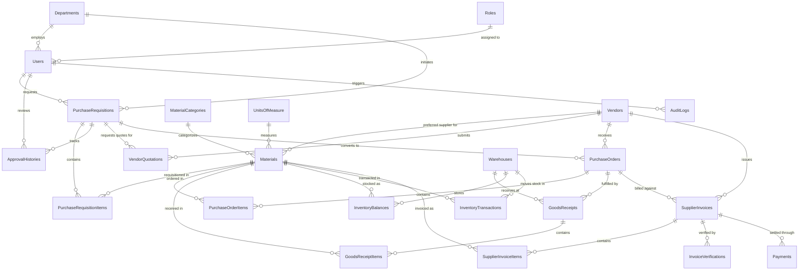

# Entity Relationship Diagram (ERD) & Database Schema Specification

**Database Engine:** Microsoft SQL Server (with EF Core Code-First ORM)  
**Schema Definition:** Normalized Relational Schema (3NF)  
**Monetary Precision:** `decimal(18,2)`  
**Quantity Precision:** `decimal(18,3)`  

---

### 1. High-Level Entity Relationship Diagram

---

### 2. Comprehensive Database Dictionary (26 Core Tables)

#### Master Data Tables
1. **Roles** (`RoleId`, `RoleName`, `Description`, `CreatedAt`)
2. **Departments** (`DepartmentId`, `DepartmentCode`, `DepartmentName`, `ManagerName`, `Budget`, `Status`, `CreatedAt`)
3. **Users** (`UserId`, `Email`, `PasswordHash`, `FullName`, `PhoneNumber`, `DepartmentId`, `RoleId`, `IsActive`, `CreatedAt`, `LastLoginAt`)
4. **Warehouses** (`WarehouseId`, `WarehouseCode`, `WarehouseName`, `Location`, `CapacitySqFt`, `Status`, `CreatedAt`)
5. **MaterialCategories** (`CategoryId`, `CategoryCode`, `CategoryName`, `Description`)
6. **UnitsOfMeasure** (`UOMId`, `UOMCode`, `UOMName`, `Description`)
7. **Vendors** (`VendorId`, `VendorCode`, `CompanyName`, `ContactPerson`, `Email`, `Phone`, `Address`, `City`, `State`, `Country`, `PostalCode`, `GSTIN`, `PAN`, `PaymentTerms`, `BankAccountRef`, `BankName`, `IFSCCode`, `VendorCategory`, `VendorRating`, `Status`, `CreatedAt`, `UpdatedAt`)
8. **Materials** (`MaterialId`, `MaterialCode`, `MaterialName`, `Description`, `CategoryId`, `MaterialType`, `BaseUOMId`, `UnitPrice`, `ReorderLevel`, `MaximumStockLevel`, `CurrentStock`, `PreferredVendorId`, `StorageLocation`, `Status`, `CreatedAt`, `UpdatedAt`)

#### Procurement & Approval Tables
9. **PurchaseRequisitions** (`RequisitionId`, `RequisitionNumber`, `RequestedByUserId`, `DepartmentId`, `RequestDate`, `RequiredDeliveryDate`, `Priority`, `TotalEstimatedAmount`, `BusinessJustification`, `Status`, `ApprovalRemarks`, `CreatedAt`, `UpdatedAt`)
10. **PurchaseRequisitionItems** (`ItemId`, `RequisitionId`, `MaterialId`, `Quantity`, `EstimatedUnitPrice`, `LineTotal`, `Remarks`)
11. **ApprovalHistories** (`HistoryId`, `RequisitionId`, `ApproverUserId`, `Action`, `Remarks`, `ActionDate`)
12. **VendorQuotations** (`QuotationId`, `QuotationNumber`, `RequisitionId`, `VendorId`, `QuotationDate`, `ValidUntil`, `Status`, `SelectionJustification`, `TotalQuotedAmount`, `PaymentTerms`, `DeliveryDays`, `CreatedAt`)
13. **VendorQuotationItems** (`QuotationItemId`, `QuotationId`, `MaterialId`, `QuotedUnitPrice`, `TaxPercentage`, `LineTotal`, `DeliveryLeadDays`, `Notes`)
14. **PurchaseOrders** (`POId`, `PONumber`, `VendorId`, `RequisitionId`, `PODate`, `ExpectedDeliveryDate`, `PaymentTerms`, `ShippingAddress`, `BillingAddress`, `WarehouseId`, `Subtotal`, `TaxAmount`, `DiscountAmount`, `GrandTotal`, `Status`, `CreatedByUserId`, `ApprovedByUserId`, `ApprovedDate`, `CreatedAt`, `UpdatedAt`)
15. **PurchaseOrderItems** (`POItemId`, `POId`, `MaterialId`, `Quantity`, `UnitPrice`, `TaxRate`, `LineSubtotal`, `LineTax`, `LineTotal`, `ReceivedQuantity`, `Status`)

#### Warehouse & Inventory Tables
16. **GoodsReceipts** (`GRNId`, `GRNNumber`, `POId`, `VendorId`, `WarehouseId`, `ReceiptDate`, `DeliveryChallanNumber`, `ReceivedByUserId`, `InspectionStatus`, `Remarks`, `CreatedAt`)
17. **GoodsReceiptItems** (`GRNItemId`, `GRNId`, `POItemId`, `MaterialId`, `OrderedQuantity`, `PreviouslyReceivedQuantity`, `CurrentReceivedQuantity`, `AcceptedQuantity`, `RejectedQuantity`, `RejectionReason`)
18. **InventoryBalances** (`BalanceId`, `MaterialId`, `WarehouseId`, `AvailableStock`, `ReservedStock`, `LastUpdated`)  
    *Unique constraint on (`MaterialId`, `WarehouseId`)*
19. **InventoryTransactions** (`TransactionId`, `MaterialId`, `WarehouseId`, `TransactionType`, `Quantity`, `ReferenceDocumentType`, `ReferenceDocumentNumber`, `TransactionDate`, `CreatedByUserId`, `Remarks`)

#### Invoicing, Verification & Settlement Tables
20. **SupplierInvoices** (`InvoiceId`, `InvoiceNumber`, `VendorId`, `POId`, `GRNId`, `InvoiceDate`, `DueDate`, `Subtotal`, `TaxAmount`, `TotalAmount`, `PaidAmount`, `OutstandingAmount`, `Status`, `VerificationRemarks`, `CreatedAt`)  
    *Unique constraint on (`VendorId`, `InvoiceNumber`)*
21. **SupplierInvoiceItems** (`InvoiceItemId`, `InvoiceId`, `MaterialId`, `BilledQuantity`, `BilledUnitPrice`, `LineTotal`)
22. **InvoiceVerifications** (`VerificationId`, `InvoiceId`, `POId`, `GRNId`, `MatchedDate`, `PriceVariance`, `QuantityVariance`, `VarianceType`, `IsMatchSuccessful`, `Remarks`, `VerifiedByUserId`)
23. **Payments** (`PaymentId`, `PaymentNumber`, `InvoiceId`, `VendorId`, `PaymentDate`, `PaymentAmount`, `PaymentMethod`, `TransactionReference`, `Status`, `RecordedByUserId`, `Remarks`, `CreatedAt`)

#### System & Audit Governance Tables
24. **AuditLogs** (`AuditId`, `UserId`, `Action`, `EntityName`, `EntityId`, `PreviousValuesJson`, `NewValuesJson`, `Timestamp`, `IPAddress`)
25. **Notifications** (`NotificationId`, `UserId`, `Title`, `Message`, `Type`, `IsRead`, `CreatedAt`, `LinkUrl`)
26. **SystemSettings** (`SettingId`, `SettingKey`, `SettingValue`, `Description`, `UpdatedAt`)
