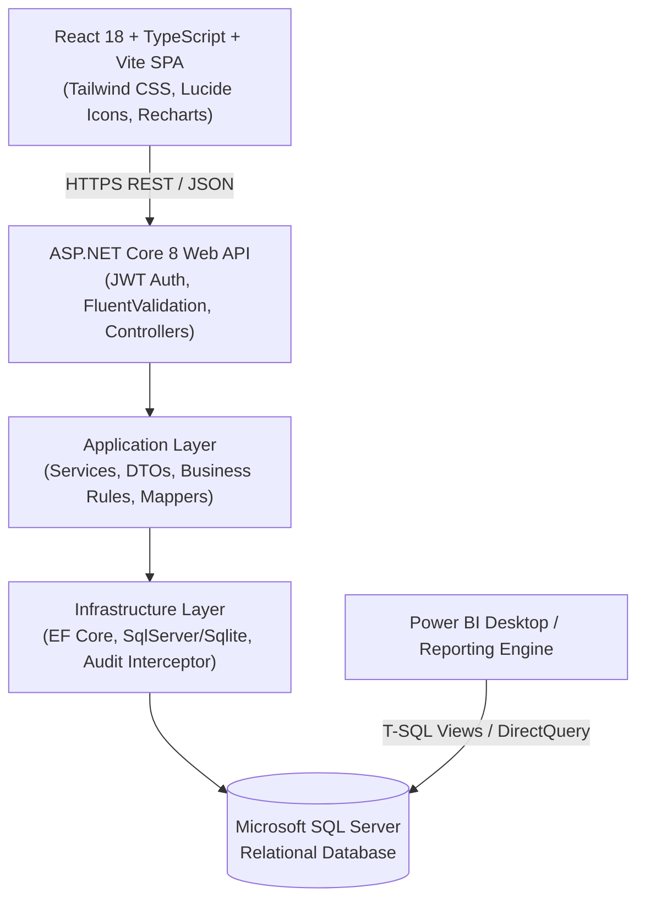

# Software Requirements Specification (SRS)
## Project: SmartProcure — Procurement & Inventory ERP Platform

**Standard:** Compliant with IEEE Std 830-1998  
**System Architecture:** Layered Clean Architecture (ASP.NET Core 8 Web API + React 18 TypeScript SPA)  
**Database:** Microsoft SQL Server (with EF Core Code-First)  

---

### 1. Introduction

#### 1.1 Purpose
This document specifies the software requirements for SmartProcure, an enterprise resource planning system tailored for procurement and inventory management adhering to SAP MM standard operational conventions.

#### 1.2 System Scope
The system manages:
- Identity & Role-Based Access Control (RBAC).
- Master Data (Vendors, Materials, Warehouses, Departments).
- Procurement Lifecycle (Requisitions, Multi-Tier Approvals, Quotations, Purchase Orders, PO PDF).
- Warehouse Receiving & Inventory Ledger (Goods Receipt Notes, Physical Inspection, Perpetual Balances).
- Accounts Payable & Invoicing (Three-Way Matching, Invoice Verification, Payment Recording).
- Executive Analytics, Dashboarding, and Power BI Datasets.

---

### 2. Overall Description

#### 2.1 Product Perspective
SmartProcure operates as an independent multi-tier client-server enterprise application:

#### 2.2 User Characteristics
- **Administrative Users:** Proficient in ERP system settings, user rights assignment, and master configuration.
- **Shop Floor / Department Users:** Create PRs quickly with minimal cognitive load; auto-populating item prices and categories.
- **Purchase & Finance Managers:** Require high-density information grids, comparative decision tables, side-by-side three-way matching, and export capabilities.
- **Warehouse Clerks:** Require fast quantity entry, inspection status dropdowns, and instantaneous stock balance feedback.

#### 2.3 General Constraints
- Backend runtime: .NET 8 LTS or higher.
- Frontend runtime: Node.js 18+ (bundled via Vite for high performance).
- Database: Microsoft SQL Server with strict foreign keys, unique indexes, and ACID transactions.
- Zero floating-point calculation for financial values (`decimal(18,2)` used exclusively).

---

### 3. System Features & Functional Modules

#### 3.1 Authentication & Authorization Module
- **JWT Bearer Token Auth:** Issues cryptographically signed JSON Web Tokens upon successful credential validation.
- **RBAC Policy Enforcement:** Every endpoint is decorated with `[Authorize(Roles = "...")]` attributes.
- **Password Security:** BCrypt / ASP.NET Identity PBKDF2 password hashing with cryptographically secure random salt.
- **Session Expiration:** Standard 8-hour working shift token expiration with refresh capability.

#### 3.2 Master Data Management Module
- **Vendor Master:** Unique vendor code (e.g., `VND-001`), tax identifiers (GSTIN, PAN), credit terms (e.g., Net 30, Net 60), performance rating.
- **Material Master:** Unique material code (e.g., `MAT-RAW-001`), standard unit of measure (KG, PCS, MTR), category, unit standard cost, reorder point, safety stock.
- **Warehouse Master:** Multi-warehouse support (e.g., Raw Materials Warehouse, Finished Goods Depot, Central Stores).
- **Department Master:** Cost center and department codes with allocated annual procurement budget.

#### 3.3 Purchase Requisition & Approval Workflow
- Generation of unique requisition numbers (`PR-YYYY-XXXX`).
- Multi-line item entry with automatic total cost calculation.
- Tiered Approval Engine:
  - Total $\le$ ₹25,000: Department Manager approval.
  - ₹25,001 to ₹1,00,000: Purchase Manager approval.
  - $>$ ₹1,00,000: Senior Executive / Director approval.
- Status transition state machine: `Draft` $\to$ `Submitted` $\to$ `PendingApproval` $\to$ `Approved` / `Rejected` / `ChangesRequested` $\to$ `ConvertedToPO`.

#### 3.4 Vendor Quotations & RFQ Evaluation
- RFQ generation for approved requisitions.
- Comparative quotation matrix scoring price, tax, estimated lead times, and payment terms.
- Selection justification recorded for audit defense.

#### 3.5 Purchase Order (PO) Management
- Creation of PO (`PO-YYYY-XXXX`) tied to approved PR and selected vendor.
- Calculation engine:
  $$\text{Line Subtotal} = \text{Quantity} \times \text{Unit Price}$$
  $$\text{Line Tax} = \text{Line Subtotal} \times \frac{\text{Tax Rate}}{100}$$
  $$\text{Grand Total} = \sum (\text{Line Subtotal} + \text{Line Tax}) - \text{Discounts}$$
- Generation of vendor-ready Purchase Order PDF documents.

#### 3.6 Goods Receipt Note (GRN) & Perpetual Inventory
- Receiving against open PO line items.
- Validation checks:
  $$\text{Current Received} \le \text{PO Ordered Quantity} - \text{Previously Received Quantity}$$
  $$\text{Accepted Quantity} + \text{Rejected Quantity} = \text{Current Received Quantity}$$
- Atomic execution: GRN creation + Inventory Balance increment + Inventory Transaction logging wrapped in an EF Core transaction.

#### 3.7 Supplier Invoice Verification & Three-Way Matching
- Automated comparison:
  1. PO Unit Price & Quantity vs.
  2. GRN Accepted Quantity vs.
  3. Supplier Invoice Billed Rate & Quantity.
- Tolerance thresholds: $\pm 2\%$ unit price variance or ₹100 total variance.
- Auto-flagging of quantity discrepancies and rate variances for Accounts Payable resolution.

#### 3.8 Payment Recording
- Tracking payments against approved invoices.
- Supports partial installments and full settlement (NEFT, RTGS, Cheque).
- Real-time adjustment of invoice outstanding balance.

---

### 4. Non-Functional Requirements

#### 4.1 Security Requirements
- All incoming payload models validated with FluentValidation / DataAnnotations.
- SQL Injection mitigation via parameterized queries and EF Core LINQ expression trees.
- Cross-Origin Resource Sharing (CORS) restricted to trusted origins.
- Sensitive financial transactions logged to immutable `AuditLogs` table.

#### 4.2 Performance & Scalability
- Sub-200ms API response time for all standard CRUD operations.
- Database indexes configured on foreign keys, document numbers (`PONumber`, `PRNumber`, `GRNNumber`), and status columns.
- Server-side pagination (`pageNumber`, `pageSize`) for all tabular data grids.

#### 4.3 Data Integrity & Concurrency
- `RowVersion` (concurrency token) enabled on financial documents and inventory records.
- Database foreign key constraints with `DeleteBehavior.Restrict` on transactional entities to prevent orphaned child records.
